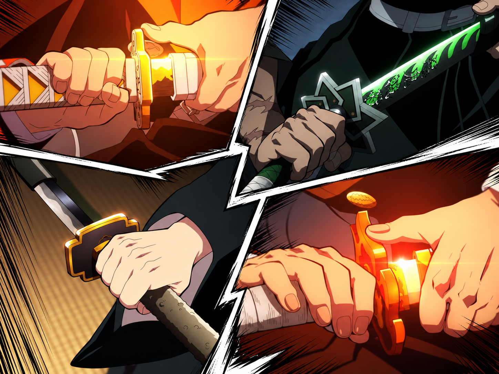
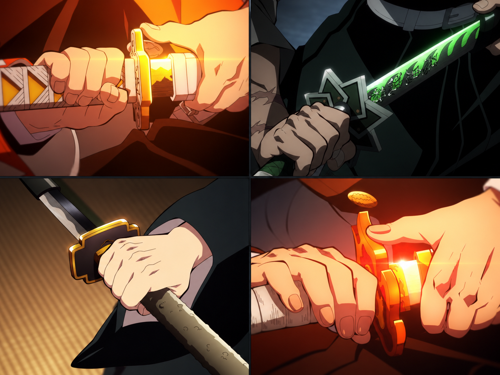
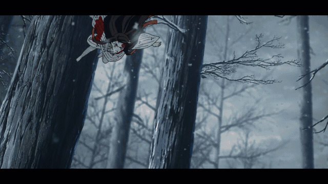
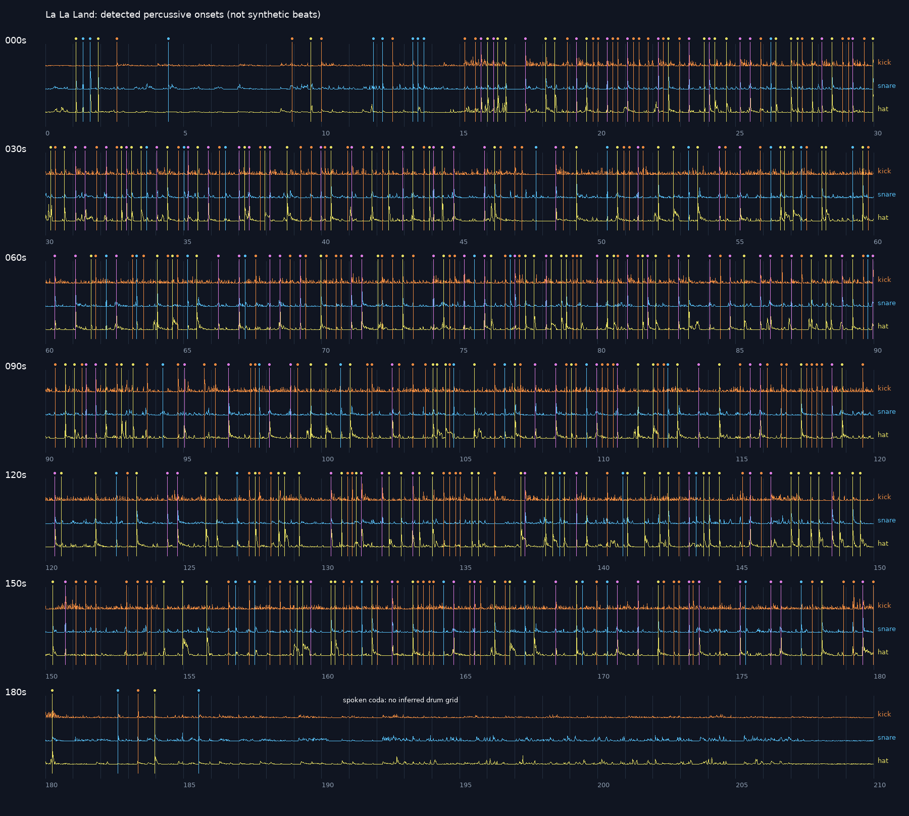

# MixCut · Action Match AMV Skill

把跨集打斗剪成连贯的动作，再让切镜、镜内命中和原片声音一起卡点。

这是从一次《鬼灭之刃》多篇章混剪中提炼的可复用 **Codex Skill**：参考拆解、素材动作标注、同向与同姿态衔接、音乐瞬态检测、同步变速与原片动作声、增量修改、成片验证，以及漫画分镜封面。附有可运行的 Python / FFmpeg 工具和完整示例时间线。

## 效果展示

### 不规则漫画封面



善逸、实弥、无一郎、炼狱的真实拔刀帧作为输入，以 imagegen 做斜切、错位和墨线毛边排版。横向 **4:3，1448×1086**。生成式排版可能重绘细节，不等同于逐像素无损拼接。

<details>
<summary>查看修改前的规则四格封面</summary>



</details>

### 动作衔接预览



约 6.2 秒循环 GIF，依次展示倒身旋转接力、低伏同向突进和三次击鼓接触。**GIF 无声**；完整版中的音乐与原片动作声不随此图片播放。它展示实际剪辑画面，不能用于判断混音听感。

### 音乐事件与段落密度



频谱峰只提供节奏证据：高频点可能来自辅音、器乐或音效，不能直接当作已人工确认的鼓声。

## 这套方法解决什么

- **素材更多但不散：** 给动作标注阶段、方向、身体轴线、景别、主体位置和刀弧形状，再跨集配对。
- **鼓点更密但动作仍可读：** 让部分鼓点由切镜承接，另一些由同一镜头里的踏地、接触、回弹承接。
- **原片音效与动作同步：** 对画面和原片声音使用同一分段时间映射，围绕发力保留短音效包络。
- **改一处不牵动全片：** 固定已经确认的时间槽，局部修剪源入出点、顺序或相邻几帧，更新对应音轨。
- **交付可追溯：** 保留时间线、源文件索引、音乐事件和混音；以真实解码、帧数与音轨验证支撑结果。

示例 V2 的规模如下。它们是这一作品的结果，不是使用 skill 的硬指标。

| 项目 | 结果 |
| --- | ---: |
| 篇章 / 不重复集数 | 5 / 43 |
| 动作单元 | 223 |
| 切镜承接的音乐瞬态 | 188 |
| 额外镜内动作承接的瞬态 | 98 |
| 去重后的节奏事件 | 286 |
| 原片动作声事件 | 206 |
| 输出 | 210.1 秒，1080p，30 fps |

细节见 [案例复盘](docs/case-study.md) 和 [V2 配方](action-match-amv/examples/v2/README.md)。本仓库提供方法、时间数据、脚本和效果演示，不附原始番剧视频、整首音乐或完整成片。原片画面及歌曲的权利仍归相应权利人，示例图片用于展示本次剪辑与排版效果。

## 使用 Skill

Skill 目录是 [`action-match-amv/`](action-match-amv)，入口为 [`SKILL.md`](action-match-amv/SKILL.md)。可将整个目录放入自己的 Codex skills 目录；例如默认的 `~/.codex/skills/`，使用自定义 `CODEX_HOME` 时放在其 `skills/` 下。

然后在有权访问素材的工作环境中使用：

```text
使用 $action-match-amv，分析参考片的动作衔接和原声卡点。
从我提供的动画文件夹选取更多集、更多篇章的打斗素材，
搭配指定音乐制作混剪，保留上一版，交付成片与可修改工程。
```

只需要封面时也可以指定：

```text
使用 $action-match-amv，从成片所用素材中选4名角色真正拔刀的瞬间，
保留原片截图与时间来源，制作4:3、不规则边缘的漫画分镜封面。
```

Skill 不会仅凭文件顺序自动挑出好动作。需要按参考文档查看候选和衔接边界，决定哪些姿态与动作阶段能连接。

## 运行辅助工具

需要 Python 3.10+，以及 PATH 中可用的 `ffmpeg`、`ffprobe`。音频分析/混音使用 NumPy、SciPy、SoundFile；联系表使用 Pillow。渲染支持 CPU `libx264`，也支持通过实际编码探测后使用 NVIDIA NVENC。

从仓库根目录执行：

```bash
python -m venv .venv
source .venv/bin/activate
python -m pip install -r action-match-amv/requirements.txt

# 不需要动画素材即可验证整个技术流程
python action-match-amv/scripts/smoke_test.py

# 音乐瞬态候选；不要把输出自动视为确定鼓点
python action-match-amv/scripts/analyze_music.py \
  --music '/path/to/music.mp3' --out work/music --fps 30

# 原片概览或动作密抽；end不包含在采样范围内
python action-match-amv/scripts/contact_sheet.py \
  --video '/path/to/episode.mp4' \
  --start 100 --end 110 --step 0.5 --out work/contact.png
```

若已确认尾段主要为对白，可用 `--music-region-end 秒数` 排除它进入优选音乐事件，但仍保留原始候选供检查。辅助检测器输出 `low/mid/high/multi` 等声学代理标签，与 V2 历史数据的 `kick/snare/hat/combined` 命名不同，二者都不是可靠的逐乐器分类。

### 按 V2 配方渲染

需要自己准备 [sources.json](action-match-amv/examples/v2/sources.json) 所列的相同版本素材和 `Jax - La La Land.mp3`。不同发行版本可能改变时间码，必须重新核对动作，不能只改文件名假定对齐。

```bash
python action-match-amv/scripts/amv.py prepare \
  --project work/v2 \
  --recipe action-match-amv/examples/v2 \
  --media-root '/path/to/anime' \
  --music '/path/to/Jax - La La Land.mp3'

python action-match-amv/scripts/amv.py check --project work/v2

# 先查看代表片段，再完成整片
python action-match-amv/scripts/amv.py render --project work/v2 \
  --shots 0,34,80-82,133,173-174 --encoder auto
python action-match-amv/scripts/amv.py render --project work/v2 --encoder auto
python action-match-amv/scripts/amv.py mix --project work/v2
python action-match-amv/scripts/amv.py assemble --project work/v2
python action-match-amv/scripts/amv.py validate --project work/v2
```

成片默认在 `work/v2/output/amv.mp4`，单镜在 `clips/`，音乐/原声/完整混音在 `audio/`，检查记录在 `reports/`。`prepare` 拒绝覆盖已有工程；要做新版请换一个工程目录。修改时间线、源素材或音乐后，重新执行受影响的渲染与混音，组装会拒绝过期产物。

完整字段、参数和示例见 [渲染工具说明](action-match-amv/scripts/CLI.md)。新作品请按 [动作匹配](action-match-amv/references/action-matching.md) 和 [节奏与原声](action-match-amv/references/rhythm-and-original-audio.md) 重新设计时间线；示例配方不是自动选材算法。

## 仓库结构

```text
action-match-amv/
  SKILL.md
  agents/openai.yaml
  requirements.txt
  references/               动作匹配、节奏原声、复核与封面
  scripts/                  音乐分析、联系表、渲染混音、合成验证
  examples/v2/              223镜头时间线、43源映射、音乐事件与案例报告
docs/
  images/                   README中的封面、动画预览与节奏图
  case-study.md             本次作品的关键决策与修正
```

## 验证范围

脚本已用合成视频/声音实际跑过端到端流程，并独立检查过接触闪帧、原声脉冲、中文与特殊字符路径、旧版保护及过期缓存拒绝。V2 配方通过 223 镜头结构检查，并抽取真实单镜验证 CPU/NVENC。**没有用公共移植脚本重新渲染并试听全部 210 秒成片**，其输出不保证与原工作站文件逐字节相同。

瞬态检测、打击成分掩膜和 `atempo` 都存在不确定性；原片配乐/喊声可能残留，变速也可能移动或涂抹起音。数值通过、联系表和完整解码不能替代实际观看与试听。GIF 与封面仅是效果展示。
